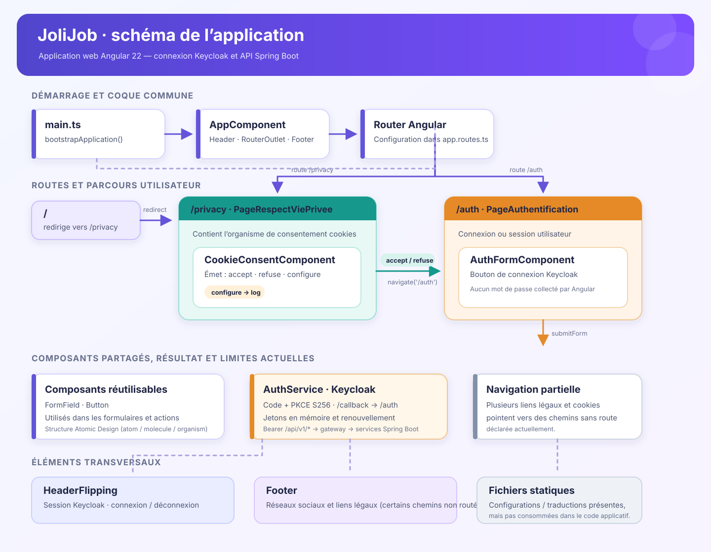

# JoliJob

Application front-end de JoliJob, basée sur [Angular](https://angular.dev) 22 (Angular CLI 22.2.4, Angular Material 22.2.4, TypeScript 6.0).

## Prérequis

- Node.js `22.23.4` (voir `.nvmrc` ; minimum requis par Angular 22 : `^22.22.3`, `^24.15.0` ou `>=26`)
- npm 11 ou supérieur (npm 10 échoue à l'installation avec l'erreur `edgesOut`)

```bash
nvm use
npm install
```

## Schéma de l'application



## Connexion et déconnexion avec Keycloak

L'authentification utilise l'adaptateur officiel `keycloak-js`, avec le flux
**Authorization Code + PKCE S256**. Le bouton **Se connecter** ouvre la page
Keycloak : aucun identifiant ou mot de passe n'est collecté par Angular.
Après connexion, le nom de l'utilisateur et le bouton **Se déconnecter**
apparaissent dans l'en-tête et sur `/auth`. La déconnexion termine la session
Keycloak et revient à la racine de l'application.

Pour le développement local :

1. Initialiser puis démarrer Keycloak en suivant le
   [guide du backend](../Back_JEE_25_Springboot_JoliJob/identity/keycloak/README.md).
   Le realm doit être `jolijob`, avec le client public `jolijob-web`.
2. Créer un utilisateur dans Keycloak, vérifier son adresse e-mail et lui
   attribuer les rôles nécessaires. L'inscription libre est désactivée.
3. Démarrer la gateway Spring Boot sur `http://localhost:8080` et les services
   métier nécessaires. Ils valident les jetons émis par
   `http://localhost:8081/realms/jolijob`, avec l'audience `jolijob-api`.
4. Lancer `npm start` puis ouvrir **http://localhost:4200** (pas `127.0.0.1`).

La configuration publique est dans `src/app/auth/auth.config.ts` :
serveur `http://localhost:8081`, realm `jolijob`, client `jolijob-web`.
Le client Keycloak doit autoriser exactement :

| Paramètre | Valeur locale |
| --- | --- |
| Valid redirect URIs | `http://localhost:4200/callback` |
| Web origins | `http://localhost:4200` |
| Valid post logout redirect URIs | `http://localhost:4200/` |

Ces valeurs correspondent au fichier `identity/keycloak/jolijob-realm.json`
du backend. Ne pas ajouter de secret client dans Angular.

Au démarrage, `check-sso` restaure une session Keycloak existante ; il peut
effectuer un aller-retour vers Keycloak et revenir sur `/auth`. Les jetons
restent en mémoire, jamais dans `localStorage` ou `sessionStorage`.
Ils sont renouvelés à expiration et avant les appels HTTP si leur validité
restante est inférieure à 30 secondes. Une erreur de connexion, de
renouvellement ou de déconnexion est affichée dans l'application.

Utiliser `HttpClient` avec des URL **`/api/v1/...`** : l'intercepteur ajoute
le jeton uniquement aux appels de cette API sur la même origine.
`proxy.conf.json` transmet `/api/**` à la gateway locale, sans modifier
le chemin ni l'en-tête `Authorization`. Ne pas appeler directement
`http://localhost:8080` depuis les composants. Un refus `401` invalide la
session locale ; un `403` reste une erreur d'autorisation. Aucune requête
métier n'est rejouée automatiquement.

En production, adapter l'URL Keycloak et les URL exactes du client à des
origines HTTPS. Le serveur du frontend doit servir `index.html` pour les
routes Angular (notamment `/callback`) et reverse-proxyfier `/api/` vers la
gateway en préservant `Authorization`. Le proxy de `ng serve` n'est pas
inclus dans le build de production. Les services Spring Boot restent
responsables de la validation des jetons et des autorisations.

## Development server

To start a local development server, run:

```bash
ng serve
```

Once the server is running, open your browser and navigate to `http://localhost:4200/`. The application will automatically reload whenever you modify any of the source files.

## Code scaffolding

Angular CLI includes powerful code scaffolding tools. To generate a new component, run:

```bash
ng generate component component-name
```

For a complete list of available schematics (such as `components`, `directives`, or `pipes`), run:

```bash
ng generate --help
```

## Building

To build the project run:

```bash
ng build
```

This will compile your project and store the build artifacts in the `dist/` directory. By default, the production build optimizes your application for performance and speed.

## Running unit tests

Les tests utilisent Vitest avec l'intégration Angular et jsdom :

```bash
npm test -- --watch=false
```

Ils couvrent la session Keycloak (avec un adaptateur simulé), PKCE, les
redirections, le renouvellement et ses erreurs, la connexion/déconnexion
dans l'interface et la restriction des jetons aux appels de la gateway.
Ils ne remplacent pas un essai réel avec Keycloak et les services démarrés.

## Running end-to-end tests

For end-to-end (e2e) testing, run:

```bash
ng e2e
```

Angular CLI does not come with an end-to-end testing framework by default. You can choose one that suits your needs.

## Additional Resources

For more information on using the Angular CLI, including detailed command references, visit the [Angular CLI Overview and Command Reference](https://angular.dev/tools/cli) page.
# jolijob_front_Angular_22
